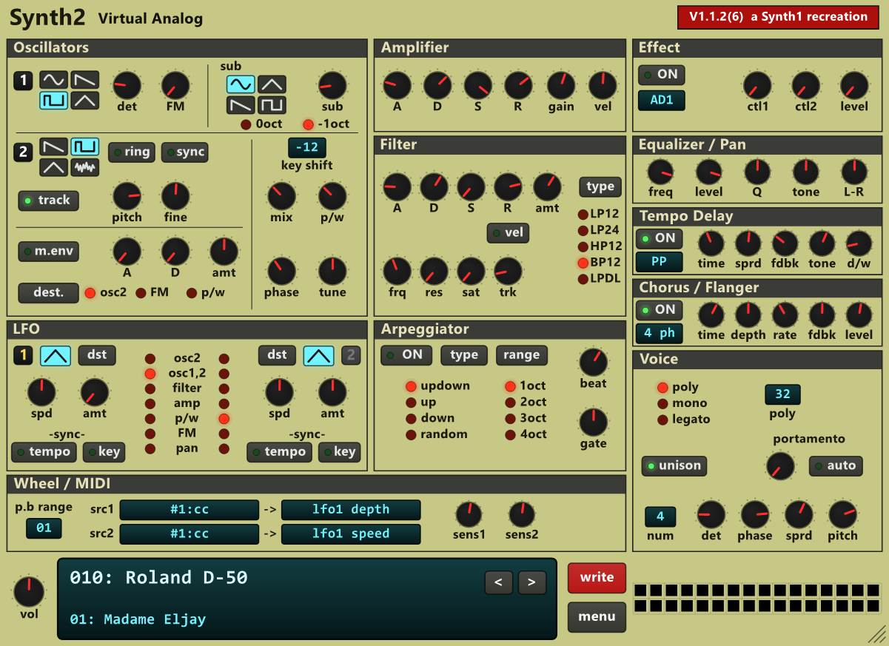
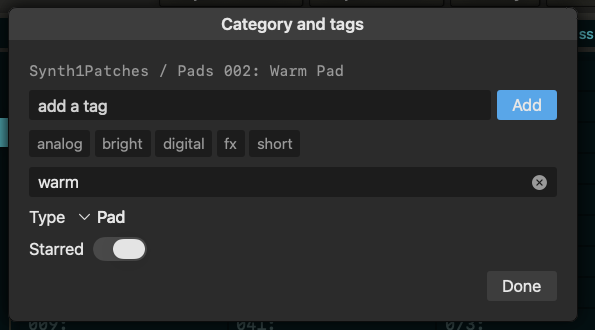
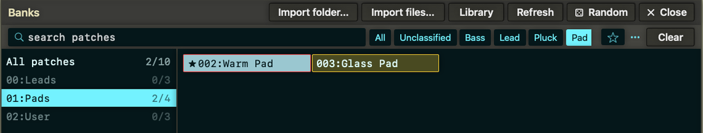
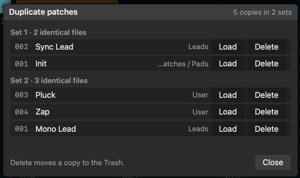
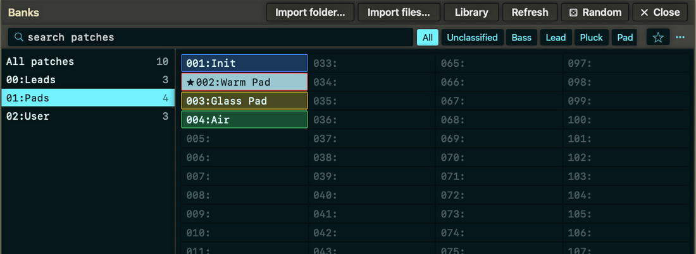
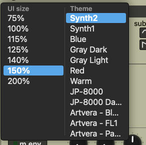

<p align="center"></p>

# Synth2

A free, open-source recreation of **Synth1**, the classic freeware synthesizer by Daichi Laboratory ([website](https://daichilab.sakura.ne.jp/softsynth/index.html)).


Synth1 has been my go-to synth for years, as it has for many musicians, with thousands of patches on the web.
Sadly, it seems to have been abandoned in recent years. No updates, no email replies. Mac users can keep it on life support with Rosetta, but Rosetta will be gone in macOS 28 (see [this article](https://developer.apple.com/news/?id=w5ngl9k2)).

Synth2 aims to keep those sounds playable on modern computers. Open source, so that anyone can keep the project alive in the future.


- **Same parameters, same UI:** Some UX improvements (MIDI Learn, themes, etc.), but nothing was changed in the synth engine.
- **Import patches:** All Synth1 patches (`.sy1` files and zip banks) load just like in Synth1.
- **Find patches fast:** browser filters by type, star or free-text tags you add, and
  keeps your marks in one portable `categories.json` you can carry to a new setup (the
  patches themselves stay plain `.sy1` files).
- **Carefully modeled with Claude:** Opus 5.5 generated ~ 3 GB of measurement data before modeling every parameter one by one.

Note: the original Synth1 was studied only through its audio output. The binary was never disassembled or decompiled (see the clean-room rule in [AGENTS.md](AGENTS.md#rules)).

Formats: macOS VST3 + AUv2, iPad AUv3, Windows VST3 (x64), Linux VST3 (x86-64, ARM64).

This is a fork of [`chab/oxo_synth2`](https://github.com/chab/oxo_synth2) and
tracks it (currently 1.1.8, build 17). It adds a patch-library browser and a
few build fixes; see [What this fork adds](#what-this-fork-adds).

## What this fork adds

Everything below is **on top of upstream** (`chab/oxo_synth2`): the synth
engine, the parameters, the panel and the `.sy1` format are unchanged, so
patches and projects move between the two freely.

### Patch browser: categories, stars, tags

A sidecar `categories.json` at the library root adds three ways to find a
patch, without touching the `.sy1` files themselves:

- **22 categories** (Bass, Lead, Pluck, Pad, Strings, Brass, Keys, Organ,
  Piano, Bell, Arp, Chord, Sequence, FX, Perc, Vocal, Guitar, Wind, Mallet,
  Texture, Init, Unclassified). Each patch is classified from its **name** by
  an ordered rule table, so a fresh library arrives sorted; any patch can be
  overridden by hand.
- **Stars** — a favourite flag per patch.
- **Free-form tags** — as many per patch as you like, so "dark pad" is
  expressible where a single category is not.

Records are keyed by the **SHA-256 of the patch's bytes**, not its path, so a
star follows a patch through a bank rename, a copy into another bank, an
export and an import. Hashing is opt-in: a library nobody has tagged pays
nothing for it. `⋯ > Export / Import categories and tags…` carries the whole
store to a new machine; imports merge, and your existing marks win.

<p align="center">
  
</p>

### Patch browser: filtering and finding

<p align="center">
  
</p>

- **Filter bar**: free text over patch, bank, category and tag names, one of
  the 22 type chips, and a star-only chip. Non-matching patches are **hidden**
  (the grid closes up) rather than dimmed, each bank row shows "matching /
  total", and the patch you are currently playing never disappears.
- **All patches** view: every bank in one flat list, narrowed by the same
  filter — the way to hunt a sound when you do not remember which bank it is
  in.

<p align="center">
  
</p>

- **Random patch**: a reservoir sample over whatever the filter lets through,
  so it hunts undiscovered sounds *inside* the style you are looking for.
  Reachable from the browser header and the LCD menu, and it works mid-scan.
- **Find duplicates…**: groups patches whose files are byte-for-byte
  identical, listing every copy's bank, slot, name and colour. Nothing is
  deleted automatically.

<p align="center">
  
</p>

### Patch browser: colours and streaming

- **Patch colours**: a patch's colour is Synth1's own `color=` line in the
  `.sy1`, so it needs no sidecar record and travels with the file. Six names
  (`default`, `blue`, `red`, `yellow`, `green`, `magenta`); cells are tinted,
  and a colour this build does not know stays untouched rather than being
  reset.

<p align="center">
  
</p>

- **Streamed scans**: a large library no longer shows nothing until the whole
  rescan ends. Banks arrive while the scan runs, already usable, with a
  "N/M banks · P patches" bar in the header.

<p align="center">
  
</p>

- **A silent library is now an error**: if the engine's library JSON cannot be
  decoded, the browser says where and why instead of looking like an empty
  library. (An older build wrote favourites as numbers where Swift expected
  booleans, so the whole document failed to decode — both sides now emit and
  accept booleans.)

These are the **mac and iPad** SwiftUI browser's. The Windows and Linux
editors share the engine, so a library tagged on the mac opens there with its
marks intact and a written patch keeps its colour, but their panels do not
draw the filter bar or the star / tag / colour menus yet.

### Editor scaling

The panel used to be drawn at its 770×560 design size and upscaled with
`.scaleEffect`, so text went soft as soon as the window grew past 100 %. Now
every length, frame and font multiplies a `\.scale` value and text is laid out
at its final size, so it stays crisp at every UI size (75–200 % on the mac).

<p align="center">
  
</p>


### Build and install

- **`--global`**: `./build_vst3.sh --global` installs the VST3 into
  `/Library/Audio/Plug-Ins/VST3` while keeping the AUv2 in
  `~/Library/Audio/Plug-Ins/Components`. The AU is deliberately kept out of
  the global folder: a `Components` folder that is a symlink onto an exFAT
  volume is not scanned by `AudioComponentRegistrar`, so an AU installed there
  never loads.
- **exFAT code seals**: exFAT cannot store xattrs, so macOS writes `._NAME`
  AppleDouble sidecars into the bundle as it is created, and those unsigned
  files break the seal. `seal_bundle` purges them, signs, and purges again
  (signing re-creates `._CodeResources`). `rsync --exclude` cannot prevent
  this — the files appear on write.
- **`moduleinfo.json` guard**: the file is regenerated when it is missing or
  0 bytes. An incremental Xcode build can skip the SDK's post-build step,
  leaving an empty file that hides the plugin from hosts that read it.

### Carried here, but now upstream too

These began as fork fixes, were filed as issues and merged into upstream
1.1.8 build 17, so they are **not** gaps any more: build and validator logs
read as text, the AUv2 `AudioComponents` version derived from
`MARKETING_VERSION`, the AUv2 installed with a real DSP bundle instead of a
build-tree symlink, and import results reported instead of failing silently.

## Download

Official builds are published on the Oxo Music website:

- macOS 14+ (VST3 + AU, signed and notarized): <https://oxo-music.com/products/oxo_synth2>
- Windows 10+ x64 (VST3): <https://oxo-music.com/products/oxo_synth2>
- iPad (AUv3): <https://apps.apple.com/us/app/oxo-synth2/id6829692180>
- Linux x86-64 / ARM64 (VST3): <https://oxo-music.com/products/oxo_synth2> or [build it yourself](#building)

Thanks to [sl23](https://github.com/sl2365) for the Windows version and [Eufex](https://github.com/eufex) for the Linux version.

## Relationship to Synth1

Synth2 is an independent recreation of Synth1 by Daichi Laboratory. It is
**not affiliated with or endorsed by** Daichi Laboratory. No Synth1 code,
binaries or artwork are used. The sound was matched only by measuring the
original plugin's audio output (clean-room; see `tools/s1ref`).

I emailed Daichi in January 2025 and October 2026 to propose
open-sourcing or supporting Synth1, and even offered to raise funds for their
time, but got no reply.

Synth1 is a trademark/work of its respective owner. Patches (`.sy1`) are
loaded for compatibility only; no Synth1 banks are distributed.

> Dear Daichi, if you're reading this: I hope you're well. I'm not trying to take over your project; I'd just love to keep Synth1 patches playable on modern computers. Please [contact me](https://oxo-music.com/support/): if you'd rather this project didn't exist, I'll take it down. Above all, I would love to see YOUR original code released under an open-source license. I'd be happy to maintain it if you're open to it.

## Building

Get the sources with their submodules (Steinberg's VST3 SDK, Apple's
AudioUnitSDK):

```sh
git clone --recursive https://github.com/chab/oxo_synth2.git
cd oxo_synth2
# (already cloned without --recursive: git submodule update --init --recursive)
```

A local build keeps the official identity: it replaces an installed Oxo Synth2
(same IDs). That's fine for development; to distribute builds, see
[Forks](#forks).

### macOS (VST3 + AUv2)

Needs a Mac with a recent Xcode (developed with Xcode 27) and CMake 3.25+.

```sh
./build_vst3.sh   # builds and installs the VST3 + AUv2 into ~/Library/Audio/Plug-Ins
```

Options: `--no-install` builds only; `--global` installs the VST3 into
`/Library/Audio/Plug-Ins/VST3` and the AUv2 into `~/Library/Audio/Plug-Ins/Components`
(the AU is kept out of the global folder on purpose — see below).

### iPad (AUv3)

Needs a Mac with a recent Xcode. Open and build `OxoSynth2.xcodeproj` in
Xcode. To run it on a device, Xcode must sign it with **your** Apple developer
team (`Identity.xcconfig` holds the official one). Don't edit that file:
create `Identity.local.xcconfig` next to it with one line:

```
DEVELOPMENT_TEAM = <your Team ID>
```

Your Team ID is shown at developer.apple.com > Account > Membership details.
The file is gitignored, so it stays on your machine.


### Windows (VST3, x64)

Needs Windows 10 / 11 x64, Git, and Visual Studio 2022 or later (Community or
Build Tools) with the "Desktop development with C++" workload, which includes
CMake, plus two individual components from the Visual Studio Installer: "C++
Clang Compiler for Windows" and "MSBuild support for LLVM (clang-cl) toolset".

Note: the build uses clang-cl, which produces faster code than MSVC for this project.

```bat
build_windows.bat   # builds Windows_Build\build\VST3\Release\OxoSynth2.vst3 (does not install it)
```

To test the plugin, close the DAW and copy the bundle into the system VST3
folder from a Command Prompt **run as administrator** (it starts in
`System32`, hence the `cd`; the `rmdir` removes the previous copy so no stale
file stays in the bundle):

```bat
cd /d C:\path\to\oxo_synth2
if exist "%CommonProgramFiles%\VST3\OxoSynth2.vst3" rmdir /S /Q "%CommonProgramFiles%\VST3\OxoSynth2.vst3"
xcopy Windows_Build\build\VST3\Release\OxoSynth2.vst3 "%CommonProgramFiles%\VST3\OxoSynth2.vst3\" /E /I /Y
```

#### Where the Windows version keeps your files

- Settings and themes: `%APPDATA%\Oxo Music\Oxo Synth2\`. Themes are saved in
  `themes.json` (the same format as on the Mac); theme files dropped into a
  `Themes\` folder next to it (`*.json`, one theme each, named after the
  file) are listed too.
- Bank library: `Documents\Oxo Music\Oxo Synth2\`.
- Portable mode: create a `Synth2_Data` folder **next to the
  `OxoSynth2.vst3` bundle** (in a folder you can write to). When it exists,
  the plugin keeps everything there instead: settings, `themes.json` and
  `Themes\` in it, banks in `Synth2_Data\Presets\`. Nothing is converted or
  moved: the usual folders stay as they are and are used again if
  `Synth2_Data` goes away. Restart the host after adding or removing it.

### Linux (VST3)

Needs CMake 3.25+, GCC 12+ (or Clang 15+), pkg-config and the X11, cairo,
fontconfig and zlib development packages (Debian / Ubuntu:
`sudo apt install build-essential cmake pkg-config libx11-dev libcairo2-dev libfontconfig-dev zlib1g-dev`).

```sh
./build_linux.sh   # builds Linux_Build/build/VST3/Release/OxoSynth2.vst3 and installs it into ~/.vst3
```

Settings and themes are kept in `~/.config/Oxo Music/Oxo Synth2/`, banks in
`~/Documents/Oxo Music/Oxo Synth2/`. Details: [Linux_Build/README.md](Linux_Build/README.md).

### Tests

```sh
make -C EngineCoreTests test
```

## Preparing installers

Both scripts read the product name, IDs and version from `Identity.xcconfig`
and write into `dist/` (gitignored).

### macOS (.pkg in a .dmg)

```sh
tools/prepare_mac_installer   # dist/mac/OxoSynth2-<version>-<build>-macOS.dmg
```

One package with Audio Unit / VST3 checkboxes, installing into
`/Library/Audio/Plug-Ins`. Signing and notarization need a Developer ID:
set `OXO_SIGN_ID_APP`, `OXO_SIGN_ID_INSTALLER` and `OXO_NOTARY_PROFILE`
(`xcrun notarytool store-credentials`). `--skip-notarize` makes a local test
build (Gatekeeper refuses it once downloaded), `--skip-build` reuses the last
build. Details at the top of the script.

### Windows (Inno Setup .exe in a .zip)

Needs, on top of the build requirements,
[Inno Setup](https://jrsoftware.org/isinfo.php) 6.3+
(`winget install JRSoftware.InnoSetup`).

```bat
tools\prepare_win_installer.bat   # dist\win\OxoSynth2-<version>-<build>-Windows-x64.exe + .zip
```

Builds the release with clang-cl (static runtime: no VC++ redistributable
needed), validates it, and packs the installer (puts the plugin in
`C:\Program Files\Common Files\VST3`) and the `.zip` (installer, `README.pdf`,
raw bundle). Authenticode signing is optional (`OXO_WIN_SIGN_SHA1` or
`OXO_WIN_SIGN_PFX`, see the top of the script); unsigned, SmartScreen warns
on first run. `--help` lists the options.

## Repository layout

| Path | Contents |
|---|---|
| `EngineCore/` | The synth engine: portable, header-only C++20 (parameters, `.sy1` codec, voices, filters, effects, patch library) |
| `EditorCore/` | Editor services shared by the VST3 and the AUv3 (C bridge to the UI, state, per-user files) |
| `Shared/` | The SwiftUI panel (mac and iPad) |
| `OxoSynth2VST3/` | VST3 plugin (+ the SDK's AUv2 wrapper), CMake |
| `DesktopEditor/` | The Windows and Linux editor (GDI+ panel; each platform adds its window) |
| `Windows_Build/` | Windows VST3: CMake project, the editor's Win32 window, vendored zlib |
| `Linux_Build/` | Linux VST3: CMake project, the editor's X11 window, GDI+ on cairo |
| `OxoSynth2.xcodeproj`, `OxoSynth2/`, `OxoSynth2AudioUnit/` | iPad app (an "open it in a host" screen) + AUv3 extension |
| `EngineCoreTests/` | Engine unit tests |
| `tools/s1ref/` | Black-box harness for the original Synth1 + the measurement / fitting scripts |
| `tools/s2render/` | Renders the same test jobs through Synth2, for comparison |
| `reference/meta/` | The measurements the engine tables are generated from |
| `third_party/` | Steinberg VST3 SDK, Apple AudioUnitSDK (git submodules) |

`AGENTS.md` is the project's catch-up file for contributors and AI coding
agents: rules, architecture, build / test commands, and the measured facts
about the original and how they were measured.

## Reference data (for engine work)

The engine's tables come from measurements of the original plugin
(`tools/s1ref`, see its README). The results are committed in
`reference/meta/`; `EngineCore/MeasuredTables.hpp` and `LegacyTables.hpp` are
generated from them.

The renders of the original Synth1 (4,270 files, 3.4 GB unpacked) are not in
the repository:

1. Download [synth2-reference.zip](https://oxo-music.com/downloads/synth2-reference.zip) (1.5 GB).
2. Unzip it at the repository root:

   ```sh
   cd oxo_synth2
   unzip ~/Downloads/synth2-reference.zip
   ```

   This adds `reference/renders/` and `reference/derived/` (both gitignored)
   next to `reference/meta/`.

What's inside:

- `reference/renders/manifest_<group>.jsonl`: one line per render, a complete
  job (all 99 parameter values, notes, length, sample rate) plus the WAV it
  produced in the original (`file`, 44.1 kHz float).
- Groups: `sweeps` (every parameter over its range), `pitch`, `filter`,
  `velocity`, and `presets` (416 real-world patches, anonymized as
  `patch0001`…).
- `reference/derived/`: measurement caches (filter / EQ transfer functions)
  used by the fitting scripts.

To compare Synth2 against the original (needs Python 3 with numpy):

```sh
make -C tools/s2render
cd tools/s1ref && python3 compare.py presets   # or sweeps, pitch, filter, velocity
```

A port to another platform can use the same data: render each manifest job
with the new engine and compare it to the WAV.

Regenerating the renders needs the original Synth1 AU, an Intel-only binary
that runs only on macOS versions that still ship Rosetta. Once Rosetta is gone,
this archive is the only way to compare against the original.

Contributors: the clean-room rule applies. Study the original only through
its audio output and its published plugin interface. Never disassemble or
decompile it, and never copy its artwork.

## Forks

You are welcome to fork and redistribute (MIT). If you work with an AI coding
agent, point it to `AGENTS.md` first: it is written for agents to catch up
with the project (rules, architecture, commands, measured facts), and most
agents read it automatically. Keep it up to date as you go.

If you ship your own builds, give them **their own identity** so they can be
installed next to the official ones without host conflicts. Every identity lives in
`Identity.xcconfig` (or override it in `Identity.local.xcconfig`); the Xcode
project, CMake, `build_vst3.sh` and both installers read it:

| Key | Used for |
|---|---|
| `OXO_PRODUCT_NAME` | Display name, bundle names (`<name>.component`, `<name without spaces>.vst3`), installer |
| `OXO_VENDOR` | VST3 vendor |
| `OXO_VENDOR_WEBSITE`, `OXO_VENDOR_EMAIL` | VST3 info, update dialog contact (host only, no `https://`) |
| `OXO_UPDATE_PRODUCT` | "Check for updates" slug on your website; **leave empty** to remove the menu entry |
| `OXO_BUNDLE_ID` | Mac `.vst3` / `.audiounit`, iPad app (as is) and extension (`.AudioUnit`), installer package IDs |
| `OXO_APP_GROUP` | iPad app group (bank library shared by the app and the extension) |
| `OXO_AU_MANUFACTURER`, `OXO_AU_SUBTYPE` | Audio Unit 4-char codes (all-lowercase manufacturer codes are reserved by Apple) |
| `OXO_AU_NAME` | Audio Unit name (`Vendor: Product`) |
| `OXO_VST3_PROCESSOR_UID`, `OXO_VST3_CONTROLLER_UID` | VST3 class IDs: generate fresh ones (`uuidgen`) |
| `OXO_DATA_FOLDER`, `OXO_LIBRARY_FOLDER` | Mac per-user folders (`~/Library/Application Support/…`, `~/Music/…`) |
| `DEVELOPMENT_TEAM` | Your Apple signing team (in `Identity.local.xcconfig`) |

Outside that file, replace the app icons:
`OxoSynth2/Assets.xcassets/AppIcon.appiconset` and
`OxoSynth2AudioUnit/Assets.xcassets/AppIcon.appiconset`.

Internal names (`OxoSynth2` targets and files, `Oxo…` message IDs) are not
visible to users and need no renaming. Keep the state tag `'OXS2'` and the
`.sy1` format as they are, so projects and patches stay compatible.

## Contributions to this repository

The scope here is Synth1 and nothing more: the goal is a faithful clone for modern computers, the next best thing to Daichi's own code. Fixes, ports and differences from how the original sounds are welcome. New features belong in forks.

If you have a suggestion for this repository, open an issue first, so that we agree on something
before you spend time on it.

## License

The code is under the [MIT License](LICENSE).

Third-party: Steinberg VST3 SDK (MIT), Apple AudioUnitSDK (Apache 2.0).

The names "Oxo", "Oxo Music" and "Oxo Synth2" and the app icons are not
covered by the code license: forks must use their own name and icons.
