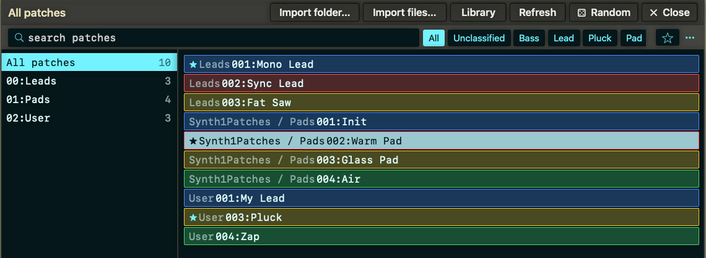

<p align="center"></p>

# Tuli Synth2

**A fork of [Oxo Synth2](https://github.com/chab/oxo_synth2) by François
Chabloz ([@chab](https://github.com/chab)).**

> **Almost none of this is my work.** The synth engine, the clean-room
> measurement of Synth1, the panel, the iPad app, the VST3/AUv2 packaging and
> the Windows/Linux ports are all **François Chabloz's** (with the Windows and
> Linux ports contributed by [sl23](https://github.com/sl2365) and
> [Eufex](https://github.com/eufex)). What this fork adds is the patch browser
> and some build fixes — listed in [What this fork adds](#what-this-fork-adds).
> If you want the plugin itself, get the **official build from the original
> author**, not from here.

Synth2 is a free, open-source recreation of **Synth1**, the classic freeware
synthesizer by Daichi Laboratory
([website](https://daichilab.sakura.ne.jp/softsynth/index.html)).

Formats: macOS VST3 + AUv2, iPad AUv3, Windows VST3 (x64), Linux VST3
(x86-64, ARM64).

This fork tracks upstream and currently matches **1.1.8, build 17**. See
[Credits](#credits) for who made what.

## About the original project

The text below is **François Chabloz's**, from the
[upstream README](https://github.com/chab/oxo_synth2), kept here so this fork
does not misrepresent the project's origins. Note the first-person "I" is
**his**, not the fork author's.

> Synth1 has been my go-to synth for years, as it has for many musicians, with
> thousands of patches on the web. Sadly, it seems to have been abandoned in
> recent years. No updates, no email replies. Mac users can keep it on life
> support with Rosetta, but Rosetta will be gone in macOS 28 (see
> [this article](https://developer.apple.com/news/?id=w5ngl9k2)).
>
> Synth2 aims to keep those sounds playable on modern computers. Open source,
> so that anyone can keep the project alive in the future.
>
> - **Same parameters, same UI:** Some UX improvements (MIDI Learn, themes,
>   etc.), but nothing was changed in the synth engine.
> - **Import patches:** All Synth1 patches (`.sy1` files and zip banks) load
>   just like in Synth1.
> - **Carefully modeled with Claude:** Opus 5.5 generated ~ 3 GB of
>   measurement data before modeling every parameter one by one.
>
> Note: the original Synth1 was studied only through its audio output. The
> binary was never disassembled or decompiled (see the clean-room rule in
> [AGENTS.md](AGENTS.md#rules)).

## What this fork adds

A better way to find patches. The synth itself, the sound and the patch files
are untouched — this is about the browser you use to pick a sound.

### Find a patch in seconds

Most people have thousands of Synth1 patches and no idea where a given sound
lives. The browser now has a **filter bar** right above the patch grid:

- **Type something** — it searches patch names, bank names, categories and
  your tags at once.
- **Pick a type** — a row of buttons (Bass, Lead, Pad, Pluck, FX…) narrows to
  just that kind of sound.
- **Or just your favourites** — one button shows only the patches you starred.

Matches stay, everything else disappears, so the grid closes up into a short
list of real candidates instead of a wall of dimmed out slots. Each bank in
the sidebar tells you how many of its patches still match, so you can see
where the hits are before clicking. The patch you're currently playing never
vanishes from under you.

<p align="center">
  
</p>

### Browse every patch at once

A new **All patches** row sits at the top of the bank list. Click it and you
get every patch in your library in one flat list, each labelled with the bank
it came from — and the filter bar works there too. No more clicking through
twenty banks looking for that one pad you heard last month.

<p align="center">
  
</p>

### Organise patches your way

Every patch can now be marked three ways, and the marks are yours — they
never change the patch file:

- **A type** — all 22 kinds, sorted out automatically from the patch name. A
  fresh library is already in order, and you can correct any patch by hand.
- **A star** — for the ones you actually reach for.
- **Tags** — as many as you like, in your own words. "dark", "warm", "short",
  "for the bridge of that song" — a single category can't say that, tags can.

Right-click any patch and choose **Edit tags…**; **Add star** and the
**Colour** menu are in the same place.

<p align="center">
  
</p>

Your marks follow the **patch itself**, not its filename — rename a bank, copy
a patch into another bank, or export and re-import it, and the tags and stars
come along. **⋯ > Export / Import categories and tags…** moves all of it to a
new computer; importing only ever adds to what you already have, so you can't
lose your own work by importing someone else's.

Nothing is hashed or tracked until you mark your first patch, so a library you
never tag costs nothing.

### Colour-code your patches

Tint a patch blue, red, yellow, green or magenta and it shows up that way in
the grid and in the All patches list. The colour is Synth1's own `color=` line
inside the patch file, so it travels with the patch and Synth1 itself sees it
too. Unfamiliar colours are left alone rather than being reset.

<p align="center">
  
</p>

### Stumble on sounds you forgot you had

**Random** picks a patch for you — and it respects whatever filter you've set,
so "random pad" or "random starred patch" actually works. It lives in the
browser header and in the LCD menu, and it's a good way to rediscover a
library you've stopped exploring.

### Clean up duplicates

**⋯ > Find duplicates…** shows you patches whose files are genuinely
identical — useful after merging several downloaded banks. Every copy is
listed with its bank and name so you can decide which to keep. Nothing is
deleted unless you click Delete.

<p align="center">
  
</p>

### Big libraries open immediately

Opening a library with tens of thousands of patches used to mean staring at
nothing until the scan finished. Banks now appear as they're read, ready to
use, with a small "2/3 banks · 7 patches" bar in the header telling you how
far along it is. You can start playing before it's done.

<p align="center">
  
</p>

### If something goes wrong, it says so

A browser with no banks used to be ambiguous — was the library empty, or
broken? If the library can't be read, you now get a message naming what went
wrong instead of a blank panel.

### Readable at any window size

The panel used to be drawn at one size and then scaled up, so text went blurry
as soon as you enlarged the window. It's now drawn at the size you choose, so
every label stays sharp from 75 % to 200 %. Pick a size from the menu that
opens when you click the **Tuli Synth2** name in the title bar — the menu also
switches themes.

<p align="center">
  
</p>

### Worth knowing

- The browser additions above are on **macOS and iPad**. On Windows and Linux
  the plugin reads and writes the same categories, stars, tags and colours —
  so a library you organise on the Mac opens there with everything intact —
  but those panels don't yet draw the filter bar or the tag menus.
- Because the marks live in a separate file next to your patches, deleting
  that file never damages a patch. Your `.sy1` files are as portable as they
  were in Synth1.

### For developers

Under the hood: a `categories.json` beside the library holds the marks, keyed
by patch content rather than path; scanning streams banks to the UI through a
worker thread; and the editor's scale is threaded through every length and
font instead of a single `scaleEffect`. See `AGENTS.md` for the details.

## Download

**The official builds are François Chabloz's, and are published on the Oxo
Music website. That is where you should get the plugin.**

- macOS 14+ (VST3 + AU, signed and notarized): <https://oxo-music.com/products/oxo_synth2>
- Windows 10+ x64 (VST3): <https://oxo-music.com/products/oxo_synth2>
- iPad (AUv3): <https://apps.apple.com/us/app/oxo-synth2/id6829692180>
- Linux x86-64 / ARM64 (VST3): <https://oxo-music.com/products/oxo_synth2>

Those are the **upstream** releases. They do **not** include this fork's patch
browser — for that, build this repository yourself (see [Building](#building));
no prebuilt fork binaries are published.

Thanks to [sl23](https://github.com/sl2365) for the Windows version and
[Eufex](https://github.com/eufex) for the Linux version.

## Relationship to Synth1

> The rest of this section is **François Chabloz's text from the upstream
> README**, unchanged. The "I" is his.

Synth2 is an independent recreation of Synth1 by Daichi Laboratory. It is
**not affiliated with or endorsed by** Daichi Laboratory. No Synth1 code,
binaries or artwork are used. The sound was matched only by measuring the
original plugin's audio output (clean-room; see `tools/s1ref`).

I emailed Daichi in January 2025 and October 2026 to propose
open-sourcing or supporting Synth1, and even offered to raise funds for their
time, but got no reply.

Synth1 is a trademark/work of its respective owner. Patches (`.sy1`) are
loaded for compatibility only; no Synth1 banks are distributed.

> Dear Daichi, if you're reading this: I hope you're well. I'm not trying to take over your project; I'd just love to keep Synth1 patches playable on modern computers. Please [contact me](https://oxo-music.com/support/): if you'd rather this project didn't exist, I'll take it down. Above all, I would love to see YOUR original code released under an open-source license. I'd be happy to maintain it if you're open to it.

### This fork's own position

This fork exists only to add a patch browser. It is **not** an official
release, is not endorsed by François Chabloz or Daichi Laboratory, and
publishes no binaries. The clean-room rules above apply here too. Nothing in
this repository claims any of his work as the fork author's.

## Building

Get the sources with their submodules (Steinberg's VST3 SDK, Apple's
AudioUnitSDK):

```sh
# this fork (includes the patch browser)
git clone --recursive https://github.com/TuliTheProgrammer/tuli_synth2.git
cd tuli_synth2

# or upstream, without the fork's additions
# git clone --recursive https://github.com/chab/oxo_synth2.git

# (already cloned without --recursive: git submodule update --init --recursive)
```

A local build keeps the official identity: it replaces an installed Oxo Synth2
(same IDs). That's fine for development; to distribute builds, or to install
this fork beside the official one, see [Forks](#forks).

### macOS (VST3 + AUv2)

Needs a Mac with a recent Xcode (developed with Xcode 27) and CMake 3.25+.

```sh
./build_vst3.sh   # builds and installs the VST3 + AUv2 into ~/Library/Audio/Plug-Ins
```

Options: `--no-install` builds only; `--global` installs the VST3 into
`/Library/Audio/Plug-Ins/VST3` and the AUv2 into `~/Library/Audio/Plug-Ins/Components`
(the AU is kept out of the global folder on purpose — see below).

### iPad (AUv3)

Needs a Mac with a recent Xcode. Open and build `OxoSynth2.xcodeproj` in
Xcode. To run it on a device, Xcode must sign it with **your** Apple developer
team (`Identity.xcconfig` holds the official one). Don't edit that file:
create `Identity.local.xcconfig` next to it with one line:

```
DEVELOPMENT_TEAM = <your Team ID>
```

Your Team ID is shown at developer.apple.com > Account > Membership details.
The file is gitignored, so it stays on your machine.


### Windows (VST3, x64)

Needs Windows 10 / 11 x64, Git, and Visual Studio 2022 or later (Community or
Build Tools) with the "Desktop development with C++" workload, which includes
CMake, plus two individual components from the Visual Studio Installer: "C++
Clang Compiler for Windows" and "MSBuild support for LLVM (clang-cl) toolset".

Note: the build uses clang-cl, which produces faster code than MSVC for this project.

```bat
build_windows.bat   # builds Windows_Build\build\VST3\Release\OxoSynth2.vst3 (does not install it)
```

To test the plugin, close the DAW and copy the bundle into the system VST3
folder from a Command Prompt **run as administrator** (it starts in
`System32`, hence the `cd`; the `rmdir` removes the previous copy so no stale
file stays in the bundle):

```bat
cd /d C:\path\to\oxo_synth2
if exist "%CommonProgramFiles%\VST3\OxoSynth2.vst3" rmdir /S /Q "%CommonProgramFiles%\VST3\OxoSynth2.vst3"
xcopy Windows_Build\build\VST3\Release\OxoSynth2.vst3 "%CommonProgramFiles%\VST3\OxoSynth2.vst3\" /E /I /Y
```

#### Where the Windows version keeps your files

- Settings and themes: `%APPDATA%\Oxo Music\Oxo Synth2\`. Themes are saved in
  `themes.json` (the same format as on the Mac); theme files dropped into a
  `Themes\` folder next to it (`*.json`, one theme each, named after the
  file) are listed too.
- Bank library: `Documents\Oxo Music\Oxo Synth2\`.
- Portable mode: create a `Synth2_Data` folder **next to the
  `OxoSynth2.vst3` bundle** (in a folder you can write to). When it exists,
  the plugin keeps everything there instead: settings, `themes.json` and
  `Themes\` in it, banks in `Synth2_Data\Presets\`. Nothing is converted or
  moved: the usual folders stay as they are and are used again if
  `Synth2_Data` goes away. Restart the host after adding or removing it.

### Linux (VST3)

Needs CMake 3.25+, GCC 12+ (or Clang 15+), pkg-config and the X11, cairo,
fontconfig and zlib development packages (Debian / Ubuntu:
`sudo apt install build-essential cmake pkg-config libx11-dev libcairo2-dev libfontconfig-dev zlib1g-dev`).

```sh
./build_linux.sh   # builds Linux_Build/build/VST3/Release/OxoSynth2.vst3 and installs it into ~/.vst3
```

Settings and themes are kept in `~/.config/Oxo Music/Oxo Synth2/`, banks in
`~/Documents/Oxo Music/Oxo Synth2/`. Details: [Linux_Build/README.md](Linux_Build/README.md).

### Tests

```sh
make -C EngineCoreTests test
```

## Preparing installers

Both scripts read the product name, IDs and version from `Identity.xcconfig`
and write into `dist/` (gitignored).

### macOS (.pkg in a .dmg)

```sh
tools/prepare_mac_installer   # dist/mac/OxoSynth2-<version>-<build>-macOS.dmg
```

One package with Audio Unit / VST3 checkboxes, installing into
`/Library/Audio/Plug-Ins`. Signing and notarization need a Developer ID:
set `OXO_SIGN_ID_APP`, `OXO_SIGN_ID_INSTALLER` and `OXO_NOTARY_PROFILE`
(`xcrun notarytool store-credentials`). `--skip-notarize` makes a local test
build (Gatekeeper refuses it once downloaded), `--skip-build` reuses the last
build. Details at the top of the script.

### Windows (Inno Setup .exe in a .zip)

Needs, on top of the build requirements,
[Inno Setup](https://jrsoftware.org/isinfo.php) 6.3+
(`winget install JRSoftware.InnoSetup`).

```bat
tools\prepare_win_installer.bat   # dist\win\OxoSynth2-<version>-<build>-Windows-x64.exe + .zip
```

Builds the release with clang-cl (static runtime: no VC++ redistributable
needed), validates it, and packs the installer (puts the plugin in
`C:\Program Files\Common Files\VST3`) and the `.zip` (installer, `README.pdf`,
raw bundle). Authenticode signing is optional (`OXO_WIN_SIGN_SHA1` or
`OXO_WIN_SIGN_PFX`, see the top of the script); unsigned, SmartScreen warns
on first run. `--help` lists the options.

## Repository layout

| Path | Contents |
|---|---|
| `EngineCore/` | The synth engine: portable, header-only C++20 (parameters, `.sy1` codec, voices, filters, effects, patch library) |
| `EditorCore/` | Editor services shared by the VST3 and the AUv3 (C bridge to the UI, state, per-user files) |
| `Shared/` | The SwiftUI panel (mac and iPad) |
| `OxoSynth2VST3/` | VST3 plugin (+ the SDK's AUv2 wrapper), CMake |
| `DesktopEditor/` | The Windows and Linux editor (GDI+ panel; each platform adds its window) |
| `Windows_Build/` | Windows VST3: CMake project, the editor's Win32 window, vendored zlib |
| `Linux_Build/` | Linux VST3: CMake project, the editor's X11 window, GDI+ on cairo |
| `OxoSynth2.xcodeproj`, `OxoSynth2/`, `OxoSynth2AudioUnit/` | iPad app (an "open it in a host" screen) + AUv3 extension |
| `EngineCoreTests/` | Engine unit tests |
| `tools/s1ref/` | Black-box harness for the original Synth1 + the measurement / fitting scripts |
| `tools/s2render/` | Renders the same test jobs through Synth2, for comparison |
| `reference/meta/` | The measurements the engine tables are generated from |
| `third_party/` | Steinberg VST3 SDK, Apple AudioUnitSDK (git submodules) |

`AGENTS.md` is the project's catch-up file for contributors and AI coding
agents: rules, architecture, build / test commands, and the measured facts
about the original and how they were measured.

## Reference data (for engine work)

The engine's tables come from measurements of the original plugin
(`tools/s1ref`, see its README). The results are committed in
`reference/meta/`; `EngineCore/MeasuredTables.hpp` and `LegacyTables.hpp` are
generated from them.

The renders of the original Synth1 (4,270 files, 3.4 GB unpacked) are not in
the repository:

1. Download [synth2-reference.zip](https://oxo-music.com/downloads/synth2-reference.zip) (1.5 GB).
2. Unzip it at the repository root:

   ```sh
   cd oxo_synth2
   unzip ~/Downloads/synth2-reference.zip
   ```

   This adds `reference/renders/` and `reference/derived/` (both gitignored)
   next to `reference/meta/`.

What's inside:

- `reference/renders/manifest_<group>.jsonl`: one line per render, a complete
  job (all 99 parameter values, notes, length, sample rate) plus the WAV it
  produced in the original (`file`, 44.1 kHz float).
- Groups: `sweeps` (every parameter over its range), `pitch`, `filter`,
  `velocity`, and `presets` (416 real-world patches, anonymized as
  `patch0001`…).
- `reference/derived/`: measurement caches (filter / EQ transfer functions)
  used by the fitting scripts.

To compare Synth2 against the original (needs Python 3 with numpy):

```sh
make -C tools/s2render
cd tools/s1ref && python3 compare.py presets   # or sweeps, pitch, filter, velocity
```

A port to another platform can use the same data: render each manifest job
with the new engine and compare it to the WAV.

Regenerating the renders needs the original Synth1 AU, an Intel-only binary
that runs only on macOS versions that still ship Rosetta. Once Rosetta is gone,
this archive is the only way to compare against the original.

Contributors: the clean-room rule applies. Study the original only through
its audio output and its published plugin interface. Never disassemble or
decompile it, and never copy its artwork.

## Forks

You are welcome to fork and redistribute (MIT). If you work with an AI coding
agent, point it to `AGENTS.md` first: it is written for agents to catch up
with the project (rules, architecture, commands, measured facts), and most
agents read it automatically. Keep it up to date as you go.

If you ship your own builds, give them **their own identity** so they can be
installed next to the official ones without host conflicts. Every identity lives in
`Identity.xcconfig` (or override it in `Identity.local.xcconfig`); the Xcode
project, CMake, `build_vst3.sh` and both installers read it:

| Key | Used for |
|---|---|
| `OXO_PRODUCT_NAME` | Display name, bundle names (`<name>.component`, `<name without spaces>.vst3`), installer |
| `OXO_VENDOR` | VST3 vendor |
| `OXO_VENDOR_WEBSITE`, `OXO_VENDOR_EMAIL` | VST3 info, update dialog contact (host only, no `https://`) |
| `OXO_UPDATE_PRODUCT` | "Check for updates" slug on your website; **leave empty** to remove the menu entry |
| `OXO_BUNDLE_ID` | Mac `.vst3` / `.audiounit`, iPad app (as is) and extension (`.AudioUnit`), installer package IDs |
| `OXO_APP_GROUP` | iPad app group (bank library shared by the app and the extension) |
| `OXO_AU_MANUFACTURER`, `OXO_AU_SUBTYPE` | Audio Unit 4-char codes (all-lowercase manufacturer codes are reserved by Apple) |
| `OXO_AU_NAME` | Audio Unit name (`Vendor: Product`) |
| `OXO_VST3_PROCESSOR_UID`, `OXO_VST3_CONTROLLER_UID` | VST3 class IDs: generate fresh ones (`uuidgen`) |
| `OXO_DATA_FOLDER`, `OXO_LIBRARY_FOLDER` | Mac per-user folders (`~/Library/Application Support/…`, `~/Music/…`) |
| `DEVELOPMENT_TEAM` | Your Apple signing team (in `Identity.local.xcconfig`) |

Outside that file, replace the app icons:
`OxoSynth2/Assets.xcassets/AppIcon.appiconset` and
`OxoSynth2AudioUnit/Assets.xcassets/AppIcon.appiconset`.

Internal names (`OxoSynth2` targets and files, `Oxo…` message IDs) are not
visible to users and need no renaming. Keep the state tag `'OXS2'` and the
`.sy1` format as they are, so projects and patches stay compatible.

## Contributions

**Upstream's rule**, which this fork follows: ask first.

> The scope here is Synth1 and nothing more: the goal is a faithful clone for
> modern computers, the next best thing to Daichi's own code. Fixes, ports and
> differences from how the original sounds are welcome. New features belong in
> forks.
>
> If you have a suggestion for this repository, open an issue first, so that we
> agree on something before you spend time on it.

For **this fork**, the patch browser is a new feature, which by upstream's own
rule does not belong upstream — so it stays here. Anything that does belong
upstream should go to
[`chab/oxo_synth2`](https://github.com/chab/oxo_synth2) as a focused pull
request from a dedicated branch, not from this fork's `master`.

## Installing this fork

A normal `./build_vst3.sh` installs to your user folders and **replaces** an
installed official build, because it uses the same plugin IDs. That's fine for
development.

- **`./build_vst3.sh --global`** puts the VST3 in the system-wide
  `/Library/Audio/Plug-Ins/VST3`, which is where this machine loads it from.
  The Audio Unit still goes to your user folder on purpose: a global
  `Components` folder that is a symlink onto an exFAT drive doesn't get picked
  up by macOS, so an AU installed there would never appear.
- **To keep both plugins side by side**, give your build its own identity — see
  [Forks](#forks). A gitignored `Identity.local.xcconfig` does exactly that,
  which is why this fork's local build shows up as "Tuli Synth2" beside "Oxo
  Synth2" instead of replacing it.

Two macOS build traps are handled automatically, in case you hit them
elsewhere:

- **exFAT drives can't store extended attributes**, so macOS litters the
  bundle with `._name` sidecar files as it's written. Those unsigned files
  break the app's code signature. The build removes them, signs, then removes
  them again (signing recreates one), so `codesign --verify` stays clean.
- **`moduleinfo.json` can silently end up empty** on an incremental Xcode
  build, hiding the plugin from hosts that read it. It's regenerated whenever
  it's missing or zero bytes.

### Already given back to upstream

Four fixes written here were sent upstream and are **now part of Oxo Synth2
1.1.8 build 17**, so they're no longer differences: readable build and
validator logs, the AU version number derived from the marketing version, the
AU shipping a real DSP bundle instead of a link into the build folder, and
import results being reported instead of failing silently.

## Credits

This project is **François Chabloz's work**. This fork would not exist
without it, and should be judged as a small addition to it.

| Who | What |
|---|---|
| **[François Chabloz](https://github.com/chab)** ([oxo-music.com](https://oxo-music.com)) | **Everything that matters:** the Synth2 engine, the clean-room measurement and modelling of Synth1 (the ~3 GB of measurement data), the panel and its themes, MIDI learn, the VST3 / AUv2 / AUv3 packaging, the iPad app, the installers, the release tooling, and the documentation. Also most of the code this fork's patch browser is built on |
| **[sl23](https://github.com/sl2365)** | The Windows VST3 port |
| **[Eufex](https://github.com/eufex)** | The Linux VST3 port |
| **Daichi Laboratory** | Synth1 itself — the instrument this recreates. Not affiliated, not involved, and no Synth1 code, binaries or artwork are used |
| **Fork author** ([@TuliTheProgrammer](https://github.com/TuliTheProgrammer)) | Only the additions listed in [What this fork adds](#what-this-fork-adds): the categories / tags / colours patch browser, filtering, streamed scans, geometric editor scaling, and a few `build_vst3.sh` fixes. Four small fixes that went upstream were also written here |

The license below is **upstream's, unchanged** — the fork author has added no
copyright line, because the substance of the project is not theirs. If you
reuse anything here, credit François Chabloz (and sl23 / Eufex for the
ports), and link <https://github.com/chab/oxo_synth2>.

Two upstream requests, which this fork respects: no Synth1 bank is bundled
(`reference/presets/` is local-only and gitignored), and the original Synth1
is studied only through its audio output.


The code is under the [MIT License](LICENSE).

Third-party: Steinberg VST3 SDK (MIT), Apple AudioUnitSDK (Apache 2.0).

The names "Oxo", "Oxo Music" and "Oxo Synth2" and the app icons are not
covered by the code license: forks must use their own name and icons.
